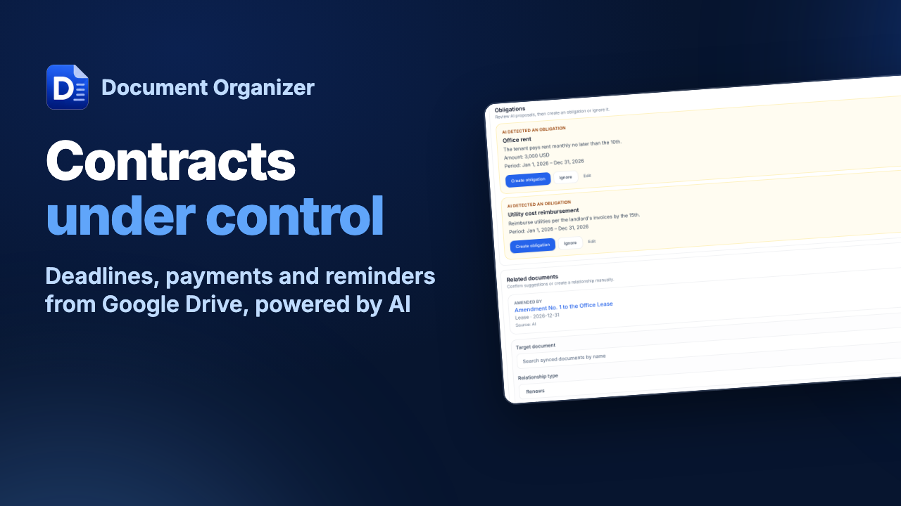
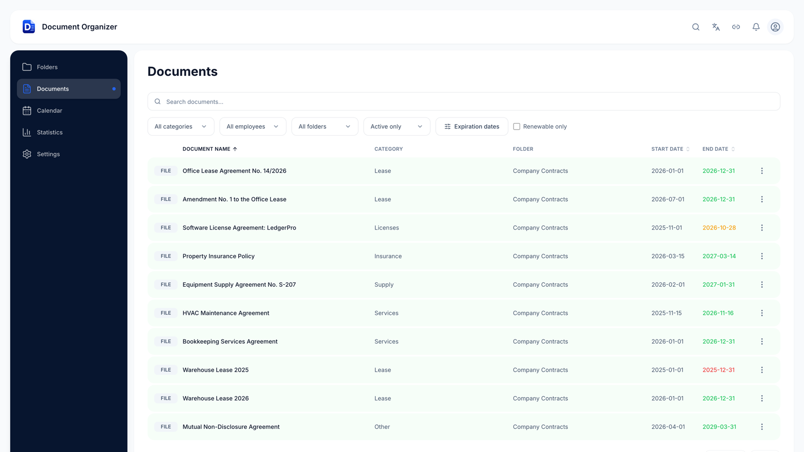
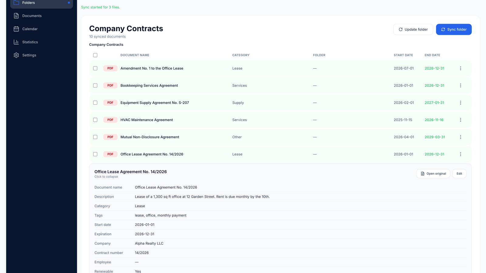
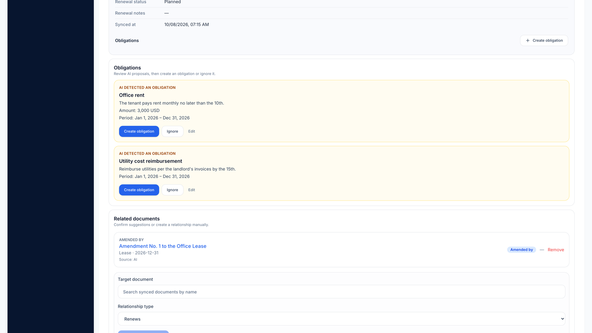
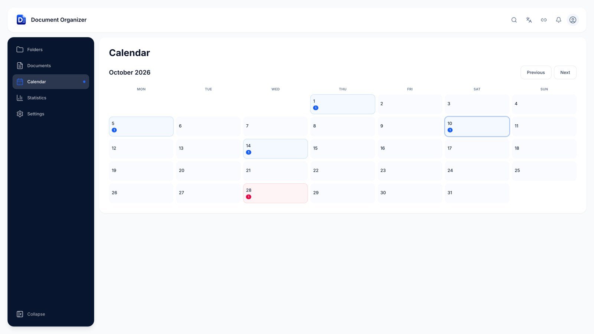
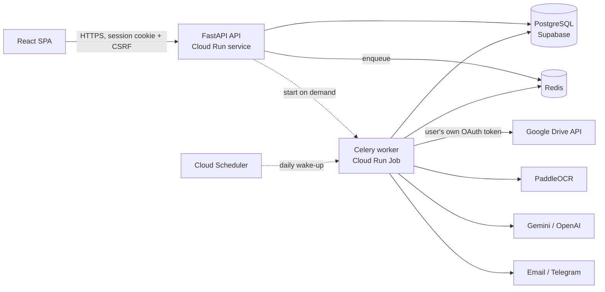

# Document Organizer

**Contracts, deadlines and payments from your Google Drive — organized by AI.**

Pick a folder in Google Drive and Document Organizer reads every contract in it:
AI extracts the parties, dates, amounts and renewal terms, finds payment and other
obligations, puts them on a calendar, links amendments to the contracts they change,
and reminds you of deadlines by email or Telegram. Drive access is read-only.

> This is a showcase repository. The product source code is private; this page
> describes what the product does and how it is built. Code walkthroughs are
> available on request.

**▶ Watch the 1-minute demo:**

*Live demo available on request.*

*All companies, people and amounts in the screenshots are fictional demo data.*

---

## What it does

| Feature | Details |
| --- | --- |
| **Google Drive sync** | Pick a folder (or several files) in Google Picker; the folder syncs in the background, including subfolders |
| **AI metadata extraction** | Description, category, tags, counterparty, contract number, start/end dates, renewal terms — from PDFs, Google Docs, scans and photos (OCR, incl. HEIC/TIFF) |
| **Obligations** | AI proposes payments and deadlines from the contract text; the user accepts, edits or ignores each one, or adds their own |
| **Calendar & reminders** | Obligations and contract end dates on a calendar; email and Telegram notifications before deadlines |
| **Document relationships** | Amendments, renewals and annexes linked into chains; AI suggests links, the user confirms them |
| **Search & filters** | By name, counterparty, tags and description; expiration and renewal filters |
| **Three languages** | Full UI in English, Spanish and Russian |
| **Plans** | Trial and subscription entitlements enforced server-side |

| AI extraction | AI-proposed obligations and linked documents |
| --- | --- |
|  |  |

---

## Architecture

A modular monolith: one FastAPI application and one Celery worker tier, built from
the same Docker image and deployed to Google Cloud Run.

### Processing pipeline

1. **Sync** — the worker lists the Drive folder with the user's own credentials and
   fans out one task per new or changed file.
2. **Text extraction** — native text from PDFs and Google Docs; OCR for scans and
   images, with size and page limits.
3. **LLM extraction** — document text is wrapped as untrusted data; the model
   returns strict JSON, which is parsed, normalized and validated server-side
   before anything is saved.
4. **Obligations** — a second LLM pass proposes obligations; they stay proposals
   until the user accepts them.
5. **Relationships** — SQL candidate generation and scoring narrow the search, then
   the LLM validates the top candidates using metadata only. Suggestions are never
   confirmed automatically.

---

## Engineering highlights

**Scale-to-zero background workers.** The Celery worker runs as a Cloud Run Job that
the API starts only when it enqueues work, and that exits after two minutes with
nothing to do. Redis keys coordinate "a worker is awake" and "a worker is starting"
so concurrent API instances start one execution, not one each. Idle detection
counts executing, prefetched, queued *and* unacked tasks — a countdown retry is
only visible in the unacked set, and missing it would cut a folder sync in half.
An integration test proves this against a real worker and Redis.

**LLM output is untrusted input.** Document text is fenced off from instructions in
every prompt (prompt-injection defense), model responses are schema-validated, and
document IDs returned by the model are resolved against the user's own data before
use. Per-user in-flight limits and a daily cost ceiling bound LLM spend.

**Multi-tenant isolation everywhere.** Every query, update and background task is
scoped to the authenticated user — including Celery tasks, which re-establish user
scope explicitly. PostgreSQL row-level security and closed PostgREST grants add
defense in depth, verified by a script on every deploy.

**Google Drive done carefully.** A Drive file ID is never treated as authorization:
every call uses the requesting user's own token, and folder containment is
re-checked (with a per-user cache that is a performance aid, not a security
boundary). OAuth tokens are encrypted at rest.

**Safe concurrency.** Enqueue-time de-duplication (atomic Redis claim) stops
duplicate sync tasks from being queued; renewable Redis leases stop two workers
from syncing the same folder. Both fail closed with bounded waits instead of
turning a Redis outage into a retry storm.

**Security baseline.** Server-side sessions with revocation, CSRF protection, rate
limiting, input validation, a secret scanner in CI and a pre-commit hook.

---

## Tech stack

| Layer | Technologies |
| --- | --- |
| Backend | Python, FastAPI, SQLAlchemy 2, Alembic, Celery, Redis, PostgreSQL (Supabase) |
| AI | Gemini and OpenAI APIs (provider-independent layer), PaddleOCR, pypdfium2 |
| Frontend | React 18, TypeScript, Vite, Tailwind CSS 4, Radix UI, TanStack Query, i18n |
| Infrastructure | Docker, Google Cloud Run (service + on-demand Job), Cloud Scheduler, Secret Manager, GitHub Actions |
| Integrations | Google Drive API, Google Picker, OAuth 2.0, email, Telegram |

## By the numbers

- ~26,000 lines of Python and ~10,000 lines of TypeScript
- 120+ backend test modules (pytest, including PostgreSQL integration tests) and 35+ frontend test files (Vitest)
- 25 sequential Alembic migrations, each backward compatible with the running version
- CI on every push; production deploys from a dedicated branch, and a deploy that
  leaves no working worker fails the pipeline

---

## Author

**Anna Komleva** — Python / ML engineer, LLM applications, full-stack.
Designed and built Document Organizer end to end (2026).

Contact: komlevaanna@gmail.com · Telegram [@a_komleva](https://t.me/a_komleva)
